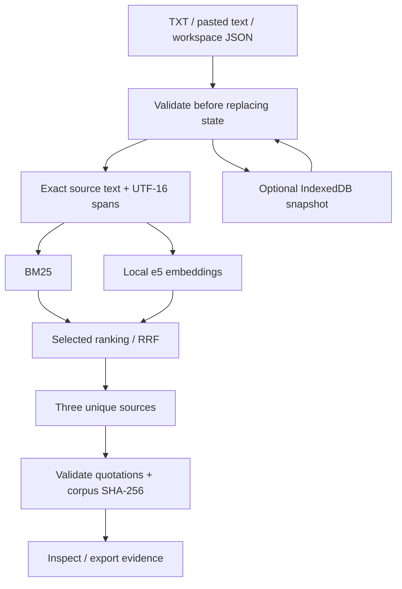

# A small evidence workspace

The flagship experiment is a browser application and an offline integrity verifier. There is no backend, account, document-access policy or generated answer.

## Contracts that matter

**Ingestion is atomic.** All documents are read and validated before replacing current state. A bad JSON file, unsupported schema version, duplicate ID or size violation cannot partly replace the corpus. Imported document titles and text are rendered as text nodes, never HTML.

**A changed corpus invalidates the index.** Document replacement clears vectors, results and evaluation, returns to lexical mode, and requires semantic re-indexing. Search and import controls are locked during asynchronous operations. Vectors are published only after all chunks are embedded successfully.

**Citations retain exact text.** Source text is not trimmed. Chunk boundaries avoid splitting surrogate pairs. Offsets use JavaScript UTF-16 code units; they are not byte offsets or user-perceived character counts. Citation validation checks integer bounds and equality with the original source slice. Result selection keeps the best chunk per source so a long document cannot occupy every visible slot.

**Export is inspectable.** A workspace contains schema version, name and documents. An evidence report contains the query, method, model configuration, corpus fingerprint and exact quotations. The CLI checks the report against the exported workspace without model downloads or an inference service. SHA-256 detects source changes; it is not a signature or proof of author identity, and someone who edits both files can recompute it.

**Local persistence is explicit.** The user saves a single snapshot in IndexedDB and manually restores it. There is no automatic save, cloud sync or persisted embedding index. Transaction completion controls success messages; a blocked/unavailable store reports failure. The snapshot is not encrypted by the app. Browser cleanup, private-mode behavior and third-party storage policies can remove or block it. JSON export is the portable backup.

## Code map

| Module | Responsibility |
|---|---|
| `retrieval/engine.js` | Tokenization, Arabic normalization, BM25 |
| `retrieval/pipeline.js` | Corpus validation, chunks, cosine, RRF, unique sources, span checks |
| `retrieval/workspace.js` | Versioned workspace contract, fingerprints, evidence export and verification |
| `retrieval/storage.js` | IndexedDB lifecycle and transactions |
| `retrieval/metrics.js` | Source-level Hit@3, Recall@3, MRR and nDCG@3 |
| `ui/retrieval-app.js` | Model lifecycle, workspace actions, search and evaluation |
| `scripts/verify-evidence.cjs` | Offline verification of actual exported files |

## Constraints

60 documents, 80,000 text characters in total, and 2,000 query characters. TXT and pasted text only; no PDF/OCR or DOCX parsing. Semantic inference uses the existing q8 e5 model in browser WASM. Runtime is pinned to Transformers.js 3.8.1; model assets resolve from the Hub main revision and are not yet pinned to a model commit. Loading can fail due to connectivity, memory, CSP or browser compatibility. Those failures are surfaced, never simulated as inference success.
